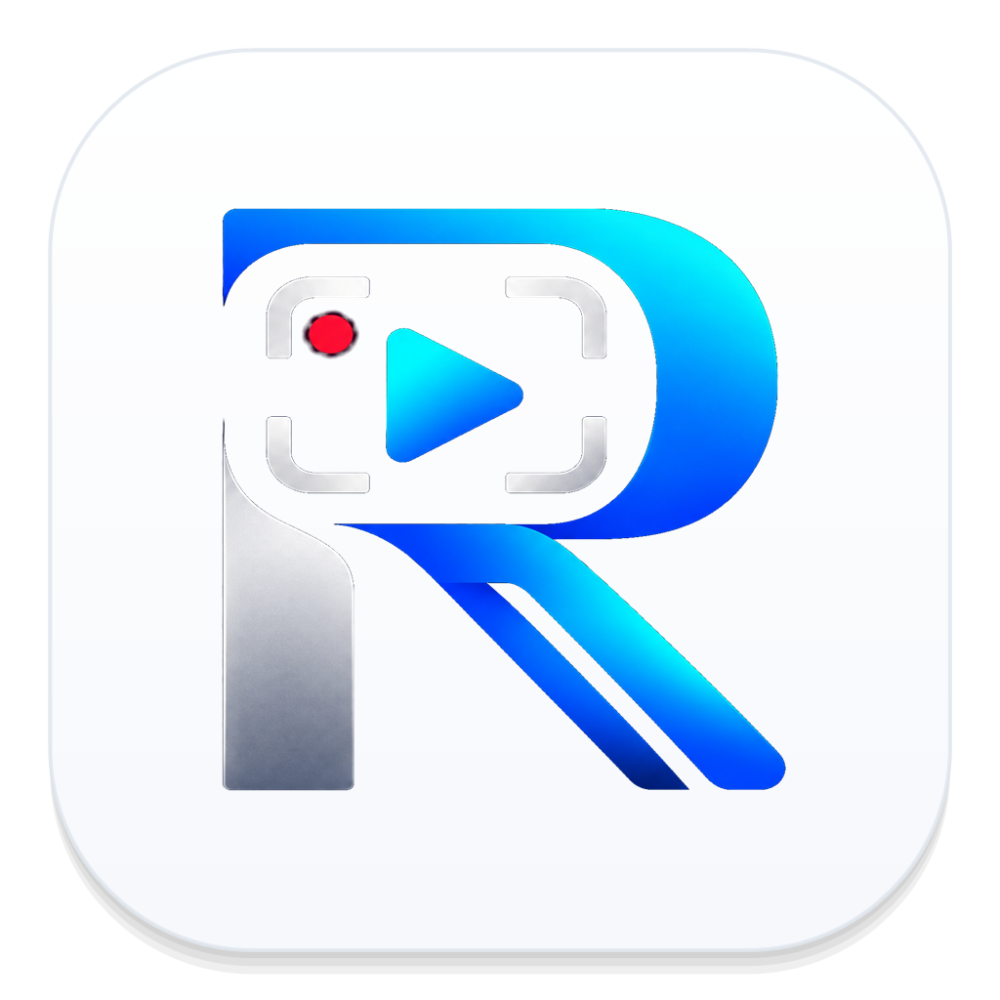

<div align="center">

  

  # 🌟 Recova Studio
  ### Next-Generation Screen Recording & Pro NLE Studio for Windows & Mac

  [](https://github.com/mohammad-sheikh-shahinur-rahman/RECOVA-STUDIO-WIKI/releases)
  [](https://apps.microsoft.com/detail/9pkq761db2ln?hl=en-GB&gl=BD)
  [](https://github.com/mohammad-sheikh-shahinur-rahman/RECOVA-STUDIO-WIKI)
  [](LICENSE)
  [](https://github.com/mohammad-sheikh-shahinur-rahman)

  <p align="center">
    <b>Turn raw desktop screen captures into cinematic, high-retention video productions in minutes.</b><br>
    Includes 3D Device Mockups, CapCut-Style Karaoke Captions, Local Whisper AI, 3D LUT Color Grading, and GPU Hardware Acceleration.
  </p>

  <p align="center">
    <a href="https://apps.microsoft.com/detail/9pkq761db2ln?hl=en-GB&gl=BD"><strong>🛍️ Get on Microsoft Store »</strong></a>
    &nbsp;•&nbsp;
    <a href="https://mohammad-sheikh-shahinur-rahman.github.io/RECOVA-STUDIO-WIKI/"><strong>🌐 Visit Official Website & Portal »</strong></a>
    &nbsp;•&nbsp;
    <a href="https://mohammad-sheikh-shahinur-rahman.github.io/RECOVA-STUDIO-WIKI/docs.html"><strong>📖 Read Documentation Wiki »</strong></a>
    &nbsp;•&nbsp;
    <a href="https://github.com/mohammad-sheikh-shahinur-rahman/RECOVA-STUDIO-WIKI/releases/tag/v1.1.1"><strong>📦 Download Direct Executables »</strong></a>
  </p>

</div>

---

## ⚡ Official Download Links (v1.1.1)

| Format | Channel / File | Size | Architecture | Direct Download |
| :--- | :--- | :--- | :--- | :--- |
| **Microsoft Store (Official)** | Store App (9pkq761db2ln) | Silent Auto-Update | Windows 10/11 x64 | [🛍️ **Get from Microsoft Store**](https://apps.microsoft.com/detail/9pkq761db2ln?hl=en-GB&gl=BD) |
| **Windows MSIX (Manual)** | `Recova-Studio-v1.1.1.msix` | `~297 MB` | Windows 10/11 x64 | [📥 Download MSIX](https://github.com/mohammad-sheikh-shahinur-rahman/RECOVA-STUDIO-WIKI/releases/download/v1.1.1/Recova-Studio-v1.1.1.msix) |
| **Windows Setup Installer** | `Recova-Studio-Setup-v1.1.0-x64.exe` | `~222 MB` | Windows 10/11 x64 | [📥 Download Setup EXE](https://github.com/mohammad-sheikh-shahinur-rahman/RECOVA-STUDIO-WIKI/releases/download/v1.1.1/Recova-Studio-Setup-v1.1.0-x64.exe) |
| **Portable Executable** | `Recova-Studio-Portable-v1.1.0-x64.exe` | `~218 MB` | Standalone USB / Any PC | [📥 Download Portable EXE](https://github.com/mohammad-sheikh-shahinur-rahman/RECOVA-STUDIO-WIKI/releases/download/v1.1.1/Recova-Studio-Portable-v1.1.0-x64.exe) |
| **macOS Apple Silicon** | `Recova-Studio-arm64.dmg` | `~180 MB` | macOS 12+ (M1/M2/M3/M4) | [🍏 Download DMG (arm64)](https://github.com/mohammad-sheikh-shahinur-rahman/RECOVA-STUDIO-WIKI/releases/download/v1.1.1/Recova-Studio-arm64.dmg) |
| **macOS Intel** | `Recova-Studio-x64.dmg` | `~185 MB` | macOS 12+ (Intel Core) | [🍏 Download DMG (x64)](https://github.com/mohammad-sheikh-shahinur-rahman/RECOVA-STUDIO-WIKI/releases/download/v1.1.1/Recova-Studio-x64.dmg) |
| **Linux Standalone** | `Recova-Studio-linux-x64.AppImage` | `~140 MB` | Linux x86_64 | [🐧 Download AppImage](https://github.com/mohammad-sheikh-shahinur-rahman/RECOVA-STUDIO-WIKI/releases/download/v1.1.1/Recova-Studio-linux-x64.AppImage) |
| **Integrity Checksums** | `SHA256SUMS.txt` | `~1 KB` | All Builds | [📄 View Checksums](https://github.com/mohammad-sheikh-shahinur-rahman/RECOVA-STUDIO-WIKI/releases/download/v1.1.1/SHA256SUMS.txt) |

---

## 🚀 Key Feature Highlights

### 1. 💻 3D Device Mockups & Dynamic Perspective
- Wrap your recordings inside **MacBook Pro 16"**, **iPhone 16 Pro**, **iPad Pro**, or **Studio Display** chassis.
- Full 3D camera rotation with **Pitch, Yaw, and Roll** dynamic tilt controls.
- Choose from gradient meshes, dynamic light ribbons, or custom video wallpaper backgrounds.

### 2. 💬 CapCut-Style Karaoke Captions & Local Whisper AI
- Transcribe speech with 100% offline **Whisper AI** with zero cloud latency and total privacy.
- Dynamic word-by-word active highlighting with energetic colors.
- Kinetic typography styles: `Pop-In`, `Typewriter`, `Fade-Up`, `Bounce`, and `Glitch`.
- Full **.SRT** and **.VTT** subtitle import and export support.

### 3. 🎨 Hollywood 3D LUT Color Grading Engine
- Import industry-standard `.CUBE` 3D lookup tables.
- Built-in cinematic grading presets: *Teal & Orange*, *Golden Hour*, *Cyberpunk*, and *Vintage Cine*.
- Real-time **RGB Waveform**, **Vectorscope**, and **Luminance Histogram** scopes.

### 4. ⚡ Speed Curves & Velocity Ramping
- Create dramatic pacing transitions with Bézier curve presets:
  - **Montage Curve:** 2x Entry → 0.5x Slow-Mo Middle → 2x Exit.
  - **Hero Shot:** 1x Normal → 0.3x Ultra Slow-Mo → 1x Normal.
  - **Bullet Time:** 3x Rapid → 0.2x Matrix Crawl → 3x Rapid.
  - **Jump-Cut Hyper:** 4x to 8x acceleration for typing or waiting screens.

### 5. 🎚️ Ripple Edit & Automatic Gap Removal
- One-click cut and gap removal with <kbd>Shift+Delete</kbd> or <kbd>X</kbd>.
- Automatically shifts all downstream video clips, audio tracks, zoom keyframes, annotations, and captions simultaneously with zero desynchronization.

### 6. 📱 Smart Auto-Reframe (9:16 Shorts & TikTok)
- Instantly reframe 16:9 widescreen captures into vertical 9:16 reels.
- The smart virtual camera smoothly tracks cursor movements and clicks without manual keyframing.

### 7. 🔊 Pro Audio Studio with EBU R128 Normalization
- Broadcast-standard EBU R128 loudness mastering (-14 LUFS YouTube / -23 LUFS Broadcast).
- Integrated Noise Gate, Dynamic Compressor, and 10-Band Graphic Equalizer.
- Built-in procedural sound effects (click, swoosh, pop).

### 8. 🚀 NVIDIA NVENC 4K60 Hardware Acceleration
- Ultra-fast video rendering powered by **NVIDIA NVENC**, **Intel QuickSync**, and **Apple Silicon VideoToolbox**.
- Multi-format export: MP4, MOV (ProRes 422), WebM (VP9), and animated GIF.
- Automatic YouTube chapter marker generator.

---

## 🔐 Cryptographic Checksums (SHA-256)

```text
310e5ead1ad215d1d701fde1be8300c2b9a162f385a4de07b2a38385de39bb  Recova-Studio-v1.1.1.msix
310e5ead1ad215d1d701fde1be8300c2b9a162f385a4de07b2a38385de39bb  Recova Studio-v1.1.1.msix
9d9557e844cef25ee0b1d15183c7621183acc9cb98950eca3b82e245938ad5f2  Recova-Studio-Setup-v1.1.0-x64.exe
cefe084b44d8bfc153fa3c5a40099dcbeea2da3fd77996c81e53288dc416179c  Recova-Studio-Portable-v1.1.0-x64.exe
```

---

## ⌨️ Essential Keyboard Shortcuts

| Shortcut | Action |
| :--- | :--- |
| <kbd>Space</kbd> | Play / Pause Playhead |
| <kbd>S</kbd> or <kbd>Ctrl+K</kbd> | Split Clip at Playhead |
| <kbd>Shift+Delete</kbd> or <kbd>X</kbd> | Ripple Delete Clip (Auto Close Gap) |
| <kbd>Z</kbd> | Insert Zoom Region Keyframe |
| <kbd>F</kbd> | Insert 2-Second Freeze Frame |
| <kbd>Alt+R</kbd> | Open Speed Curves & Velocity Ramp Modal |
| <kbd>Ctrl+Shift+R</kbd> | Start Screen Recording |
| <kbd>Ctrl+Shift+S</kbd> | Stop Screen Recording |
| <kbd>Ctrl+E</kbd> | Open 4K Export Dialog |

---

## 💻 System Requirements

- **Operating System:** Windows 10 (Build 19041+) / Windows 11 (64-bit) or macOS 12+ (Monterey, Ventura, Sonoma, Sequoia)
- **Processor:** Intel Core i3 8th Gen / AMD Ryzen 3 / Apple Silicon M-Series
- **Memory:** 4 GB RAM minimum (16 GB recommended for 4K60 editing)
- **Graphics:** NVIDIA GeForce GTX 1050 or higher with NVENC support, Intel Iris Xe / Arc, AMD Radeon RX 5000+, or Apple Silicon GPU
- **Storage:** 600 MB free hard drive space (Fast NVMe SSD recommended for 4K capture)

---

## 👨‍💻 Author & Maintainer

**Mohammad Sheikh Shahinur Rahman**  
*IT Amadersomaj Inc*  
GitHub: [@mohammad-sheikh-shahinur-rahman](https://github.com/mohammad-sheikh-shahinur-rahman)

---

*© 2026 Recova Studio. All rights reserved.*
